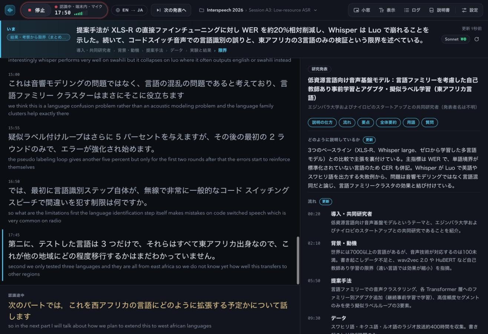

# 学会通訳要約ちゃん

講演・学会発表・会議の話し言葉を，その場で **音声認識** し，**翻訳** し，**「いま何の話か」まで要約** する Web アプリです．
パソコン版の Google Chrome でページを開くだけで使えます（インストール・登録は不要）．

**アプリ：https://sayonari.github.io/tsuyakuYouyakuChan/**
**説明書：https://sayonari.github.io/tsuyakuYouyakuChan/guide.html**



## できること

- **音声認識**：Chrome 内蔵の音声認識（端末内／クラウド）．20 以上の言語
- **翻訳**：Chrome 内蔵の翻訳（Translator API）．話している途中の文も先に訳す．翻訳なしも可
- **要約**：いま話されていること・何の発表か・どう説明しているか・流れ・要点・全体要約・用語・質問の候補を，一定間隔で更新
  - Chrome 内蔵 AI（Gemini Nano）：インストール不要・オフライン
  - Claude（Sonnet / Haiku / Opus）：補助プログラム経由．Claude Code のサブスク枠で追加料金なし
  - ローカル LLM（Ollama）：補助プログラム経由．オフライン
- **学会向けの記録**：発表ごとに記録し，「学会 › セッション」で整理．「次の発表へ」で認識を止めずに切り替え（取り消し可）
- **Zoom・Meet**：タブ・画面の音声を認識．常に手前に出る「小窓」
- **ログ**：一覧・全文検索・読み返し・Markdown／JSON 書き出し

## 補助プログラム（任意）

Claude やローカル LLM で要約したいとき，記録をフォルダに保存したいときに使います．

```sh
git clone https://github.com/sayonari/tsuyakuYouyakuChan.git
cd tsuyakuYouyakuChan
python3 server.py          # Mac は start.command をダブルクリックでも可
```

- 127.0.0.1:8765 だけで待ち受けます．公開ページ（https://sayonari.github.io）と，自分自身から配信した画面以外からの呼び出しは断ります
- Claude で要約するには [Claude Code](https://claude.com/claude-code) にログインしておきます
- ローカル LLM を使うには [Ollama](https://ollama.com/) とモデル（例：`ollama pull qwen3:8b`）を入れます．モデルは要約のときだけ読み込み，使わなくなって 10 分でメモリから外します
- 記録は `sessions/<学会>/<セッション>/` に JSON と Markdown で保存します
- アプリの「設定」→「補助プログラム」→「接続を確認」でつながります

## 動作環境

- パソコン版 Google Chrome（最新版）．Windows・Mac
- スマホのブラウザは未対応（Chrome の内蔵翻訳・内蔵 AI がスマホ版に無いため）

## データの行き先

| 処理 | どこで |
|---|---|
| 音声認識（端末内） | パソコンの中だけ |
| 音声認識（クラウド） | Google |
| 翻訳・Gemini Nano・ローカル LLM | パソコンの中だけ |
| Claude で要約 | 書き起こしの文字が，利用者自身の Claude Code を通して Anthropic へ |
| 記録 | ブラウザ内（IndexedDB）または補助プログラムのフォルダ |

## 構成

| ファイル | 役割 |
|---|---|
| `index.html`・`assets/app.js`・`assets/style.css` | 記録画面 |
| `logs.html`・`assets/logs.js`・`assets/logs.css` | ログ画面 |
| `guide.html`・`assets/guide.css` | 説明書 |
| `assets/store.js` | 保存先の切り替え（補助プログラム／IndexedDB） |
| `assets/prompt.json` | 要約の指示文と JSON スキーマ（サーバと Gemini Nano で共通） |
| `server.py`・`start.command` | 補助プログラム（Python 標準ライブラリのみ） |

音声認識とマイク・タブ音声の取得には，[音声認識字幕ちゃん v2](https://sayonari.github.io/jimakuChan/v2/) の部品（`recognizer.js`・`mic.js`，MIT License）を同じサイトから読み込んで使っています．

## 開発者

さよなりω/(大学教員)西村良太

## ライセンス

MIT License
